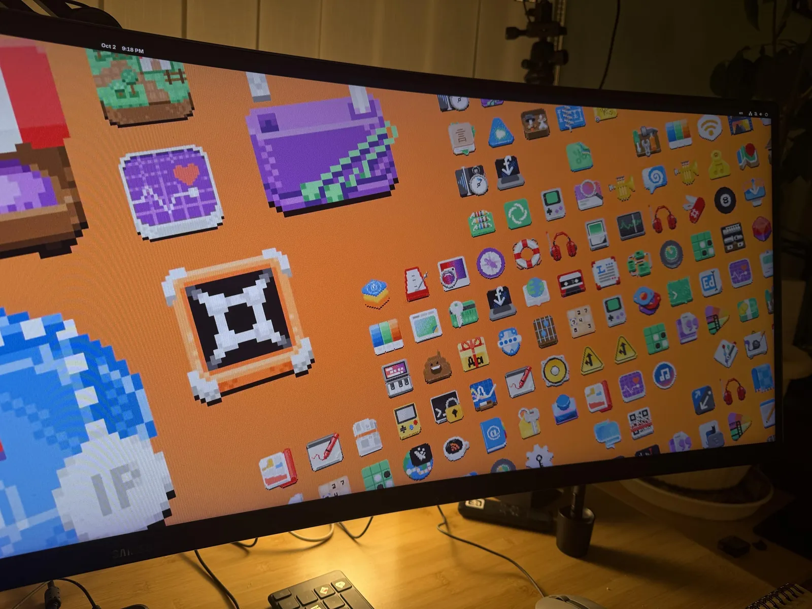

+++
title = "Pixels Wallpaper Update"
description = "Pixelart hammer strikes again! gnome-backgrounds receives a megapixel update."
date = 2026-10-15
aliases = ["/2026/pixelart-wallpapers/"]
slug = "pixelart-wallpapers"
[taxonomies]
tags = ["pixelart", "wallpaper", "art", "gnome", "blender", "work"]
[extra]
image = "thumb.webp"
# mastodon_url = "https://mastodon.social/@jimmac/REPLACE_AFTER_PUBLISH"
related = [
  "posts/2026-09-16-gnome51-wallpapers/index.md",
  "posts/2026-04-25-app-pixels/index.md",
]
audio = "speech.opus"
+++

Usually I blog about new additions to the [GNOME wallpapers](https://gitlab.gnome.org/GNOME/gnome-backgrounds) after a release, to give some behind the scenes look on how they were produced. This time I'm asking for some feedback beforehand.

<!-- more -->

`Pixels` has shipped as a wallpaper before. The wallpaper landed back in 2021 and keeps getting refreshed as new [Circle](https://circle.gnome.org) apps join the lineup, and 47 added `LCD` and `LCD-rainbow`, revealing the curator's pixelart kink.

The raw material is a side project years in the making — app icons redrawn as chunky pixels ([Pixels](/posts/pixels/), [Mo' Pixels](/posts/mopixels/), [Revert That Vector Nonsense!](/posts/app-pixels/)). 

The idea and layout remains the same as the old wallpaper. This time that's more than two variants though. The old Adwaita default used to cycle morning, day and night variants through a slideshow. While we switched to the dark/light variants, the format is still understood today. Thus `pixelart` comes in not 2, not 3, but 9 color variants. And here's where I'd like your feedback. Do you like the focus on contrast and having the whole set with dark background colors? Should there be more bright colors in the mix? Do you think the grain goes against the spirit of the pixel art? Is the small grid too toned down with the depth fog?

<video controls loop class="image full" poster="depth-fog.webp">
<source src="depth-fog.webm" type="video/webm">
<source src="depth-fog.mp4" type="video/mp4">
</video>

As always, the Blender project files are available in [wallpaper-assets](https://gitlab.gnome.org/Teams/Design/wallpaper-assets-2026) if you want to poke at the node setup yourself:

As with any wallpaper, don't judge it based on a preview, regardless of how large you view it. Apply it, use it. The most straightforward way to test GNOME development is with [GNOME OS](https://os.gnome.org). It ships `pixels` and all the other wallpapers.