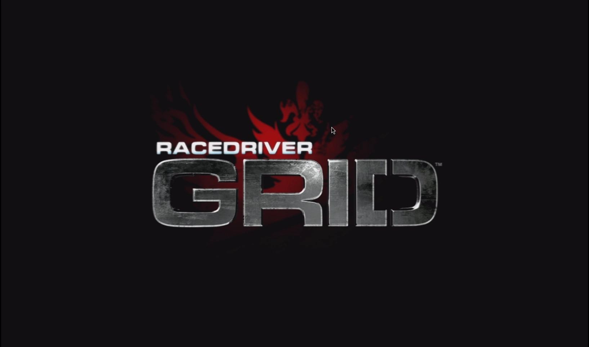

+++
title = "I am playing Grid right now!"
description = "The world of emulators is insane, but sometimes you have to visit the madhouse to play some of the classics."
date = 2026-10-30
aliases = ["/2026/udev-dualsense/"]
[taxonomies]
tags = ["linux", "gnome"]
[extra]
image = "thumb.webp"
audio = "speech.opus"
related = [
  "posts/2023-05-01-udev-m8/index.md",
  "posts/2026-09-18-building-flatpaks-locally/index.md",
  "posts/2025-10-28-usb-midi-m8/index.md",
]
+++
I never liked racing "sims" like Gran Turismo. So realistic! You can bounce off the guardrails like in a pinball. [Grid](https://en.wikipedia.org/wiki/Race_Driver:_Grid) on the other hand was a fantastic "arcade" racer with a brilliant damage model where mistakes were punished. And the camera work! And music. Boy, that was such a treat!

Nostalgia stroke me fiercely and I needed to play that game in some form. Among a sea of weird remakes, there simply wasn't a platform you could play the proper original *Racedriver: Grid* on, other than emulators. So I bit the bullet and dove into the craziness of [RPCS3](https://flathub.org/en/apps/net.rpcs3.RPCS3).

That UX is crazy, let me tell you. In the end you get a game playable even on an old workstation, which was a surprise in itself. A much bigger surprise was the support for network play.. Obviously not a single soul is playing Grid in 2026, but it's a fun thought I might convince someone to play :)



<div id="controller-view" class="controller-view">

</div>

*3D model: ["Playstation 5 Dualsense"](https://sketchfab.com/3d-models/playstation-5-dualsense-878c1f882808477ab81c2fe86d5a3936) by [AHarmlessPotato](https://sketchfab.com/AHarmlessPotato), [CC-BY-4.0](http://creativecommons.org/licenses/by/4.0/).*

<script src="three.min.js"></script>
<script src="gltf-loader.js"></script>
<script src="controller-view.js"></script>
<script>
ControllerView({
  container: 'controller-view'
});
</script>

Anyway, the reason to post this is to remind myself in the future how to get my PS5 *DualSense* controller to work on [GNOME OS](https://os.gnome.org/). As always, a udev rule. Having this config in `/etc/udev/rules.d/70-dualsense.rules`:

```
# DualSense over USB (054c:0ce6)
KERNEL=="hidraw*", SUBSYSTEM=="hidraw", ATTRS{idVendor}=="054c", ATTRS{idProduct}=="0ce6", MODE="0660", TAG+="uaccess"
# DualSense over Bluetooth (054c:0ce5)
KERNEL=="hidraw*", SUBSYSTEM=="hidraw", ATTRS{idVendor}=="054c", ATTRS{idProduct}=="0ce5", MODE="0660", TAG+="uaccess"
KERNEL=="hidraw*", KERNELS=="*054C:0CE5*", MODE="0660", TAG+="uaccess"
# DualSense Edge over USB (054c:0df2) / Bluetooth (054c:0df4)
KERNEL=="hidraw*", SUBSYSTEM=="hidraw", ATTRS{idVendor}=="054c", ATTRS{idProduct}=="0df2", MODE="0660", TAG+="uaccess"
KERNEL=="hidraw*", SUBSYSTEM=="hidraw", ATTRS{idVendor}=="054c", ATTRS{idProduct}=="0df4", MODE="0660", TAG+="uaccess"
KERNEL=="hidraw*", KERNELS=="*054C:0DF4*", MODE="0660", TAG+="uaccess"
```

Reload the rules and replug (the ACL is re-applied on every plug, so it persists across reboots and replugs):

```bash
run0 udevadm control --reload-rules && run0 udevadm trigger
```

Check things work from inside RPCS3's sandbox:

```bash
flatpak run --command=sh net.rpcs3.RPCS3 -c 'test -r /dev/hidraw9 && test -w /dev/hidraw9 && echo OK'
```

Now, in RPCS3:

1. Open Configuration → Pads
2. Player 1, Handler: DualSense
3. Click Refresh — the DualSense should now appear in the device list and respond to stick wiggle and whatnot.

But again, the experience of this monstrosity. Briefly looking over Alice' shoulder at what's she's cooking with [Highscore](https://gitlab.gnome.org/World/highscore), the difference in experience and polish is night & day. 